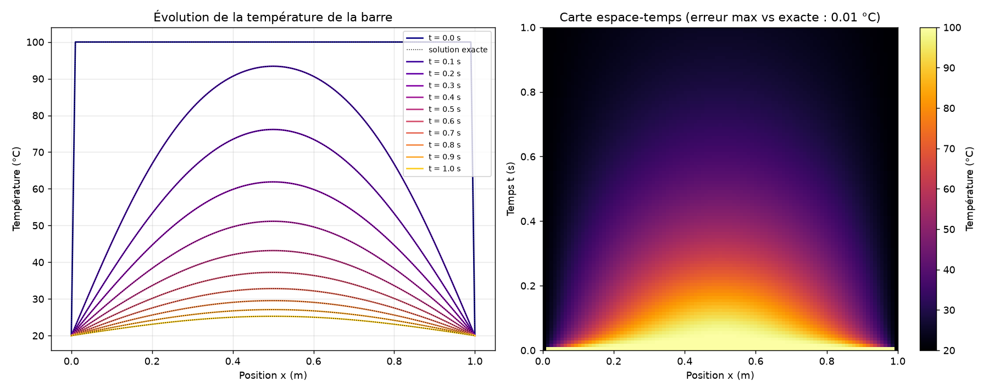

# Diffusion thermique 1D

Équation de la chaleur dT/dt = D d²T/dx² par différences finies explicites.

```
pip install numpy matplotlib pytest
python diffusionThermique.py      # génère diffusion_thermique.png
pytest                            # tests (comparaison à la solution exacte)
```


